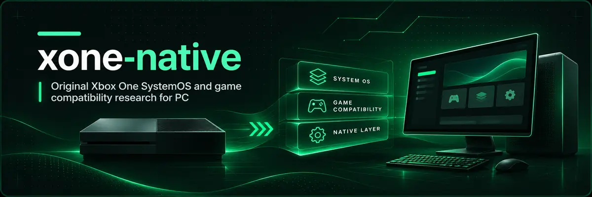

<div align="center">
  

  # xone-native

  **An open research project to run original Xbox One system components and games on PCs, with the authentic SystemOS dashboard as its central goal.**

  [](https://github.com/fabegalo/xone-native/actions/workflows/build.yml?query=branch%3Amain)
  [](#current-status)
  [](#current-status)
  [](LICENSE)

  [English](README.md) · [Português (Brasil)](README.pt-BR.md) · [Documentation](docs/README.md) · [Contributing](CONTRIBUTING.md)
</div>

> **Early research software — no playable games, original SystemOS boot, working dashboard, GUI launcher or end-user release yet.** The banner above is concept art, not a capture of running Xbox One software. A successful build or XVD header inspection is not proof of Xbox One compatibility.

## What is xone-native?

Xbox One software targets **x86-64**, but its original environment consists of separate HostOS, SystemOS and GameOS/ERA components, with Xbox-specific virtualization, services, devices, graphics interfaces and security. Matching the CPU architecture alone does **not** make its executables ordinary desktop Windows programs.

The project's central objective is to launch the **original SystemOS shell and dashboard**, navigate it with a controller, access local profiles, Guide and library, launch a supported game **from that dashboard**, and return to the original shell. The future desktop launcher is only for content management and preparation; it must never imitate or replace the console's dashboard.

The preferred strategy is direct x86-64 execution **when technically demonstrated**, with a modular compatibility layer for Xbox services and a VM-based or hybrid SystemOS path only when required by real dependencies. GameOS/ERA and later GameCore need separate contracts. This is not a port of x360-native's PowerPC AOT/ReXGlue architecture.

<a id="current-status"></a>

## Current status

**M0 — host-side, read-only file inspection.** The project has a C++20/CMake CLI, library and synthetic regression tests. No original Xbox One executable has been demonstrated running.

| Component | Actually implemented | Not demonstrated |
|---|---|---|
| **XVD inspection** | Recognizes the header at `0x200` and reports structural metadata | Signature verification, readable payload, decryption, SystemOS boot |
| **PE32+ x64 inspection** | Reports image properties, DLL imports and imported symbols | Xbox-specific provenance, NT/WinRT activation, executable launch |
| **Build and tests** | Portable CMake targets; local M0 tests previously passed | Runtime compatibility; functional platform validation |
| **SystemOS / original dashboard** | Architecture and obstacles documented | Original frame, boot, navigation, Guide, profiles |
| **GameOS / ERA / graphics** | Research and integration boundaries | Game startup, sound, rendering, gameplay or return to dashboard |

A GitHub Actions workflow **is configured** for Windows, Linux and macOS host builds/tests. Its existence does not establish runtime support on those systems. Windows x64/ARM64, Linux x64/ARM64 (including Steam Deck on Linux x64), and macOS Intel/Apple Silicon are **long-term targets**, not supported downloads.

The documented SystemOS build `10.0.10586.1029` is only an **inspection reference**, not a proven easiest or bootable target. Selection of the first real dashboard requires legitimate, readable, version-consistent components. See [M0 findings](docs/M0.md) and [project status](STATUS.md).

## Try the current M0 inspector

This is a **developer tool**, not a launcher. You need CMake and a C++20 compiler. From the repository root:

```sh
cmake -S . -B build -DCMAKE_BUILD_TYPE=Release
cmake --build build --config Release
ctest --test-dir build -C Release --output-on-failure
```

Run it on files that you lawfully possess and are authorized to analyze:

```sh
./build/xone-native inspect /path/to/system.xvd --json
./build/xone-native inspect /path/to/component.exe
```

With a Windows multi-config generator, the executable is typically `build\Release\xone-native.exe`; locate the executable in the selected generator's output directory. The inspector does **not** copy, unpack, decrypt, authenticate, modify or execute the input. A PE32+ result does not identify a binary as Xbox One software on its own.

There are **no downloadable user releases** at this stage. Do not present the repository source archive as a playable application.

## Architecture and design rules

```text
Future desktop launcher (management and preparation only)
  └── Shared content inventory / version profiles / SHA-256
        ├── SystemOS session
        │     ├── Original component activation / compatibility boundary
        │     ├── Optional VM boundary if truly required
        │     └── Original shell, presentation, input, profiles, storage
        └── GameOS session
              ├── ERA x86-64 loader and KernelX / Xbox WinRT contracts
              ├── D3D11.X, audio, controller and storage adapters
              └── Return-to-SystemOS session coordination
```

- **Authenticity:** only original, legally obtained components may render the dashboard; no screenshots, mock shell or fake Guide may count as the real system.
- **Exact version isolation:** original modules and assets must match their SystemOS revision, provenance and hashes. No cross-version fallback or shared cache of version-specific originals.
- **Performance with correctness:** measure before/after against equivalent workloads; preserve graphics, timing, security boundaries and storage behavior. No fake-success stubs or per-game hacks in shared paths.
- **One shared codebase:** isolate OS-specific adapters without duplicating games, system components, projects or large caches. Keep original inputs unchanged and use version-aware, content-addressed caching only where justified.
- **Honest evidence:** distinguish identified, loaded, initialized, rendering, interactive, gameplay, playable and fully functional. Test fixtures and successful compilation alone are not runtime evidence.

The planned graphics directions are **Xbox** (original behavior and fidelity) and **Native** (measured PC enhancements without visual or timing regressions). Neither renderer is implemented yet. Further boundaries and blockers: [docs/M0.md](docs/M0.md).

## Roadmap

Goals, not compatibility claims:

1. **M0:** identify legally readable system inputs and map imports/dependencies (currently: read-only XVD/PE inspector).
2. **M1:** present the **first authentic frame** drawn by an original SystemOS component with recorded evidence.
3. **M2–M3:** original shell, navigation, Guide, local profiles and persistent storage.
4. **M4:** GameOS/ERA execution through verified KernelX, Xbox WinRT and graphics/audio/input contracts.
5. **M5:** dashboard → game → Guide/dashboard, lifecycle and save/restore.
6. **M6:** validated additional host architectures, optimized graphics/performance and user-friendly distributions.

## FAQ

<details><summary><strong>Does “native” mean Xbox One software already runs like a Windows app?</strong></summary>
No. The CPU architecture is similar, but the Xbox APIs, application model, VM services and original shell still need implementation or isolation. No original SystemOS code has been executed by xone-native yet.
</details>

<details><summary><strong>Can I boot my Xbox One dashboard or play games today?</strong></summary>
No. M0 inspects limited file metadata. The original dashboard, launcher, games and graphics runtimes are not functional.
</details>

<details><summary><strong>Why not just copy WinDurango or the Xbox 360 project?</strong></summary>
[WinDurango](https://github.com/WinDurango/WinDurango) targets Windows-hosted ERA game compatibility and uses LGPL-3.0. It does not provide a finished original SystemOS boot path. x360-native targets a different console and PowerPC AOT pipeline. Reuse requires a technical and license review, not an unverified source copy.
</details>

<details><summary><strong>Does the project ship firmware or bypass Xbox protections?</strong></summary>
No. Do not submit or distribute Microsoft firmware, game files, proprietary assets, keys, personal saves or extracted protected content. No DRM-bypass or key-extraction mechanism is part of this project.
</details>

## Contributing and documentation

Focused code changes, synthetic fixtures, reproducible reports, upstream research and documentation improvements are welcome. Start with [CONTRIBUTING.md](CONTRIBUTING.md); coding agents must follow [AGENTS.md](AGENTS.md) and [CLAUDE.md](CLAUDE.md). Do not submit original Xbox files or account identifiers in issues or logs.

| Document | Purpose |
|---|---|
| [STATUS.md](STATUS.md) | Dated, evidence-based progress and known limitations |
| [M0 technical report](docs/M0.md) | Verified facts, architecture choice, first-frame blockers and next increment |
| [Documentation index](docs/README.md) | Technical reading order and reference links |
| [Agent rules](AGENTS.md) / [persistent context](CLAUDE.md) | Permanent requirements for code and tests |
| [Security](SECURITY.md) | Responsible vulnerability reporting |

## License and acknowledgements

Original xone-native code is under [BSD-3-Clause](LICENSE). Third-party components retain their own terms; none are vendored at M0. See the public research in [Xbox One Research](https://github.com/xboxoneresearch/wiki), [WinDurango](https://github.com/WinDurango/WinDurango) and public [Azimuth](https://almost-there-games.itch.io/azimuth) documentation. Azimuth's source is not available for reuse here. [x360-native](https://github.com/fabegalo/x360-native) is a separate, inspirational project.

Not affiliated with, sponsored or endorsed by Microsoft. Xbox and related names are trademarks of their owners. The banner is original abstract concept art, **not** a system or gameplay capture.
