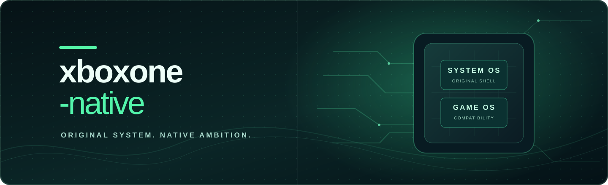

<div align="center">
  

  # xone-native

  **Projeto aberto de pesquisa para executar componentes originais do Xbox One e jogos no PC, com a dashboard autêntica do SystemOS como objetivo central.**

  [](https://github.com/fabegalo/xboxone-native/actions/workflows/build.yml?query=branch%3Amain)
  [](#estado-atual)
  [](#estado-atual)
  [](LICENSE)

  [English](README.md) · [Português (Brasil)](README.pt-BR.md) · [Documentação](docs/README.md) · [Como contribuir](CONTRIBUTING.md)
</div>

> **Pesquisa em estágio inicial — ainda não existem jogos jogáveis, boot do SystemOS original, dashboard funcional, launcher gráfico nem Release para usuários.** O banner acima é uma ilustração conceitual, não uma captura do Xbox One em funcionamento. Compilar o projeto ou ler um cabeçalho XVD não comprova compatibilidade com o console.

## O que é o xone-native?

O Xbox One executa código **x86-64**, mas seu ambiente original envolve HostOS, SystemOS e GameOS/ERA separados, com virtualização, serviços, dispositivos, APIs gráficas e mecanismos de segurança próprios. Ter uma CPU compatível **não** transforma seus executáveis automaticamente em aplicativos Windows comuns.

O objetivo central do projeto é iniciar o **shell e a dashboard originais do SystemOS**, navegar com controle, usar perfis locais, Guide e biblioteca, abrir um jogo **pela própria dashboard** e retornar ao sistema original. O futuro launcher desktop servirá apenas para gerenciar e preparar arquivos; jamais deverá imitar ou substituir a dashboard do console.

A estratégia preferencial é executar x86-64 diretamente **quando isso for demonstrado tecnicamente**, com uma camada modular de compatibilidade e um caminho de SystemOS virtualizado ou híbrido somente se dependências reais exigirem. GameOS/ERA e GameCore posterior possuem contratos diferentes. Não se deve copiar o AOT PowerPC/ReXGlue do x360-native para este projeto.

<a id="estado-atual"></a>

## Estado atual

**M0 — inspeção de arquivos somente leitura, no host.** O projeto contém CLI e biblioteca C++20/CMake, além de testes sintéticos. Nenhum executável original do Xbox One foi demonstrado funcionando aqui.

| Componente | Implementado de fato | Não demonstrado |
|---|---|---|
| **Inspeção XVD** | Reconhece o cabeçalho em `0x200` e informa metadados estruturais | Assinatura validada, conteúdo legível, descriptografia, boot do SystemOS |
| **Inspeção PE32+ x64** | Informa características da imagem, DLLs importadas e símbolos | Origem Xbox comprovada, ativação NT/WinRT, execução |
| **Build e testes** | Targets CMake portáveis; testes locais M0 aprovados anteriormente | Compatibilidade de runtime; validação funcional por plataforma |
| **SystemOS / dashboard original** | Arquitetura e obstáculos documentados | Primeira imagem original, boot, navegação, Guide, perfis |
| **GameOS / ERA / gráficos** | Pesquisa e fronteiras de integração | Início de jogos, áudio, renderização, gameplay ou retorno à dashboard |

Há um workflow do GitHub Actions **configurado** para compilar/testar em Windows, Linux e macOS. Isso não comprova execução dos sistemas do console nessas plataformas. Windows x64/ARM64, Linux x64/ARM64 (incluindo Steam Deck no Linux x64) e macOS Intel/Apple Silicon são **objetivos futuros**, não downloads suportados.

O build documentado de SystemOS `10.0.10586.1029` é apenas **referência de inspeção**, não uma versão comprovadamente mais fácil ou inicializável. A escolha da primeira dashboard real depende de componentes legítimos, legíveis e da mesma versão. Veja [pesquisa M0](docs/M0.md) e [estado do projeto](STATUS.md).

## Experimente o inspetor M0

Esta é uma **ferramenta para desenvolvedores**, não um launcher. É necessário CMake e compilador C++20. Na raiz do repositório:

```sh
cmake -S . -B build -DCMAKE_BUILD_TYPE=Release
cmake --build build --config Release
ctest --test-dir build -C Release --output-on-failure
```

Analise somente arquivos que você possui legalmente e está autorizado a examinar:

```sh
./build/xone-native inspect /caminho/para/system.xvd --json
./build/xone-native inspect /caminho/para/componente.exe
```

No Windows, com gerador multiconfiguração, o executável normalmente fica em `build\Release\xone-native.exe`; confirme o diretório de saída do gerador. O inspetor **não** copia, extrai, descriptografa, autentica, modifica nem executa o arquivo. Identificar PE32+ sozinho não comprova que o binário pertence ao Xbox One.

**Não existem Releases para usuários** neste estágio. O arquivo de código-fonte do GitHub não é um aplicativo jogável.

## Arquitetura e regras do projeto

```text
Futuro launcher desktop (somente gerenciamento/preparação)
  └── Inventário compartilhado / perfis de versão / SHA-256
        ├── Sessão SystemOS
        │     ├── Ativação de componente original / fronteira de compatibilidade
        │     ├── Fronteira de VM opcional se realmente necessária
        │     └── Shell original, apresentação, entrada, perfis, armazenamento
        └── Sessão GameOS
              ├── Loader ERA x86-64 e contratos KernelX / Xbox WinRT
              ├── Adaptadores D3D11.X, áudio, controle e armazenamento
              └── Coordenação de retorno à sessão SystemOS
```

- **Autenticidade:** somente componentes originais obtidos legalmente podem produzir a dashboard; capturas, cópias de telas e Guide falso não contam como sistema real.
- **Isolamento exato de versões:** módulos e recursos originais devem corresponder à revisão, proveniência e hashes do SystemOS. Nada de fallback entre versões nem cache global de originais específicos.
- **Desempenho com correção:** medir antes/depois sob condições equivalentes, preservando gráficos, temporização, segurança e armazenamento. Nada de stubs com sucesso falso ou hacks por jogo no código comum.
- **Uma única base de código:** isolar adaptadores de plataforma sem duplicar jogos, componentes de sistema, projetos ou caches enormes. Preservar entradas originais e usar cache por conteúdo e versão somente quando necessário.
- **Evidência honesta:** distinguir identificado, carregado, inicializado, renderizando, interface interativa, gameplay, jogável e plenamente funcional. Testes sintéticos e compilação não comprovam execução do console.

Os modos gráficos planejados são **Xbox** (fidelidade ao original) e **Native** (melhorias medidas no PC sem regressões de imagem ou tempo). Nenhum renderizador foi implementado ainda. Veja [docs/M0.md](docs/M0.md).

## Roadmap

Objetivos, não afirmações de compatibilidade:

1. **M0:** identificar entradas legítimas e legíveis e mapear imports/dependências (atualmente: inspetor XVD/PE somente leitura).
2. **M1:** apresentar a **primeira imagem autêntica** produzida por um componente original do SystemOS, com evidências.
3. **M2–M3:** shell original, navegação, Guide, perfis locais e armazenamento persistente.
4. **M4:** execução GameOS/ERA com contratos KernelX, Xbox WinRT e gráficos/áudio/controle verificados.
5. **M5:** dashboard → jogo → Guide/dashboard, ciclo de vida e salvar/restaurar.
6. **M6:** outras plataformas validadas, otimizações gráficas e distribuição simples para usuários.

## Perguntas frequentes

<details><summary><strong>“Nativo” significa que software de Xbox One já roda como aplicativo Windows?</strong></summary>
Não. A CPU é semelhante, mas APIs Xbox, modelo de aplicativos, serviços de VM e shell original precisam ser implementados ou isolados. O xone-native ainda não executou código original do SystemOS.
</details>

<details><summary><strong>Já consigo abrir a dashboard do Xbox One ou jogar?</strong></summary>
Não. O M0 inspeciona metadados limitados. Dashboard, launcher, jogos e runtimes gráficos não estão funcionais.
</details>

<details><summary><strong>Por que não copiar o WinDurango ou o projeto do Xbox 360?</strong></summary>
O [WinDurango](https://github.com/WinDurango/WinDurango) foca jogos ERA no Windows e usa LGPL-3.0; não fornece um boot pronto do SystemOS original. O x360-native usa outra arquitetura de console e AOT PowerPC. Reutilização exige análise técnica e de licença, não cópia sem validação.
</details>

<details><summary><strong>O projeto distribui firmware ou burla proteções do Xbox?</strong></summary>
Não. Não envie nem redistribua firmware Microsoft, jogos, recursos proprietários, chaves, saves pessoais ou dados extraídos de conteúdo protegido. Quebra de DRM e extração de chaves não fazem parte do projeto.
</details>

## Como contribuir e documentação

Correções focadas, testes sintéticos, relatos reproduzíveis, pesquisa de referências e documentação são bem-vindos. Comece por [CONTRIBUTING.md](CONTRIBUTING.md); agentes de programação devem seguir [AGENTS.md](AGENTS.md) e [CLAUDE.md](CLAUDE.md). Não publique arquivos originais do Xbox nem IDs de contas em issues ou logs.

| Documento | Conteúdo |
|---|---|
| [STATUS.md](STATUS.md) | Progresso datado com evidências e limitações |
| [Relatório técnico M0](docs/M0.md) | Fatos verificados, arquitetura, obstáculos da primeira imagem e próxima etapa |
| [Índice da documentação](docs/README.md) | Ordem de leitura e referências técnicas |
| [Regras dos agentes](AGENTS.md) / [contexto persistente](CLAUDE.md) | Regras permanentes de código e testes |
| [Segurança](SECURITY.md) | Comunicação responsável de vulnerabilidades |

## Licença e agradecimentos

O código original do xone-native usa [BSD-3-Clause](LICENSE). Dependências externas mantêm as próprias licenças; nenhuma é incorporada ao código do M0. Referências: [Xbox One Research](https://github.com/xboxoneresearch/wiki), [WinDurango](https://github.com/WinDurango/WinDurango) e documentação pública do [Azimuth](https://almost-there-games.itch.io/azimuth). O código-fonte do Azimuth não está disponível para reutilização aqui. O [x360-native](https://github.com/fabegalo/x360-native) é um projeto independente que inspira a proposta.

Sem afiliação, patrocínio ou endosso da Microsoft. Xbox e marcas relacionadas pertencem a seus titulares. O banner é uma arte conceitual original, **não** uma captura do sistema ou de jogos.
